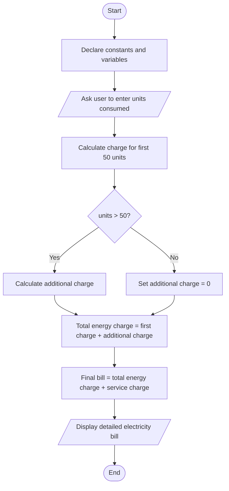

# Task 2: Electricity Bill Calculation System

## 1. Problem Description

Write a C++ program that calculates the monthly electricity bill of a customer based on the number of electricity units consumed. The program should calculate the energy charge according to the given rates, add a fixed service charge, and display the total amount the customer must pay.

## 2. Problem Analysis

### Input
- Number of electricity units consumed.

### Processing
- The first 50 units are charged at 1.50 Birr per unit.
- Any units above 50 are charged at 2.00 Birr per unit.
- A fixed service charge of 10 Birr is added.
- Calculate the final bill using the conditional operator.

### Output
- Number of electricity units consumed.
- Charge for the first 50 units.
- Charge for additional units.
- Total energy charge.
- Service charge.
- Final amount to pay.

## 3. Process

1. Start the program.
2. Declare the required constants and variables.
3. Ask the user to enter the number of electricity units consumed.
4. Calculate the charge for the first 50 units.
5. Check whether the electricity consumption is greater than 50 units.
6. If consumption is greater than 50, calculate the additional charge. Otherwise, set the additional charge to zero.
7. Add the first charge and additional charge to get the total energy charge.
8. Add the service charge to calculate the final bill.
9. Display the detailed electricity bill.
10. End the program.

## 4. Program Design (Algorithm)
### 4.1 Variables: what and how?
| Variable | Type |	Why this type? |
|---|---|---|
| units	|int	| Electricity units are whole numbers. |
| energyCharge |	double	| The charge may contain decimals. |
| serviceCharge	|double |	Stores the fixed service charge. |
| totalBill |	double |	Stores the final bill. |

### 4.2 Constants
```cpp
const int UNIT_LIMIT = 50;
const double FIRST_RATE = 1.50;
const double EXTRA_RATE = 2.00;
const double SERVICE_CHARGE = 10.00;
```

### 4.3 Reading the input
```cpp
cout << "Enter electricity units consumed: ";
cin >> units;
```
### 4.4 Calculation
```cpp
energyCharge = (units <= UNIT_LIMIT)
             ? units * FIRST_RATE
             : (UNIT_LIMIT * FIRST_RATE) +
               ((units - UNIT_LIMIT) * EXTRA_RATE);

totalBill = energyCharge + SERVICE_CHARGE;
```
### 4.5 Printing the result
```cpp
cout << fixed << setprecision(2);

cout << "Energy charge: " << energyCharge << endl;
cout << "Service charge: " << SERVICE_CHARGE << endl;
cout << "Total bill: " << totalBill << endl;
```
## 5. Flowchart



## 6. C++ Source Code

The complete C++ source code is available in Electricity_Bill.cpp.

## 7. Sample Test Runs

### Test 1: Consumption Above 50 Units

Input:
- Electricity units: 80

Calculation:
- First 50 units = 50 * 1.50 = 75 Birr
- Additional 30 units = 30 * 2.00 = 60 Birr
- Energy charge = 75 + 60 = 135 Birr
- Service charge = 10 Birr
- Total bill = 145 Birr

Output:
- Electricity consumed: 80 kWh
- Total energy charge: 135.00 Birr
- Service charge: 10.00 Birr
- Total amount to pay: 145.00 Birr

### Test 2: Consumption Below 50 Units

Input:
- Electricity units: 30

Calculation:
- First 30 units = 30 * 1.50 = 45 Birr
- Additional units = 0 Birr
- Energy charge = 45 Birr
- Service charge = 10 Birr
- Total bill = 55 Birr

Output:
- Electricity consumed: 30 kWh
- Total energy charge: 45.00 Birr
- Service charge: 10.00 Birr
- Total amount to pay: 55.00 Birr
