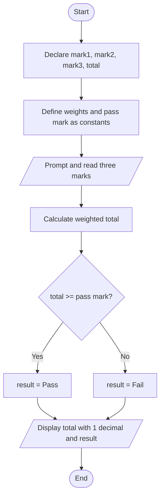

# Task 1: Student Course Result System

## 1. Problem Description

Write a program that calculates a student's total course score using assignment, midterm, and final exam scores. The program should determine whether the student passes or fails.

## 2. Problem Analysis

### Input
- Assignment score
- Midterm score
- Final exam score

### Processing
- Assignment contributes 20%.
- Midterm contributes 30%.
- Final exam contributes 50%.
- Calculate the weighted total.
- Determine the result using the conditional operator.

### Output
- Student's total score.
- Pass or Fail status.

## 3. Process

1. Declare variables to store the three marks and the total.
2. Define the assessment weights and pass mark as constants.
3. Display a prompt and read the three marks.
4. Calculate the weighted total using the given percentages.
5. Use the conditional operator to determine whether the student passes or fails.
6. Display the total mark with one decimal place and the result.

## 4. Program Design (Algorithm)
### 4.1 Variables: what and how?
| Variable | Type | Why this type? |
|---|---|---|
| assignment | double | Marks may contain decimal values. |
| midterm | double | Marks may contain decimal values. |
| finalExam | double | Marks may contain decimal values. |
| total | double | The calculated total may contain decimals. |
| result | string | Stores either Pass or Fail. |

### 4.2 Constants
```cpp
const double ASSIGNMENT_WEIGHT = 0.20;
const double MIDTERM_WEIGHT = 0.30;
const double FINAL_WEIGHT = 0.50;
const double PASS_MARK = 50.0;
```

### 4.3 Reading the input
```cpp
cout << "Enter assignment, midterm and final marks: ";
cin >> assignment >> midterm >> finalExam;
```

### 4.4 Calculation
```cpp
total = (assignment * ASSIGNMENT_WEIGHT)
      + (midterm * MIDTERM_WEIGHT)
      + (finalExam * FINAL_WEIGHT);

result = (total >= PASS_MARK) ? "Pass" : "Fail";
```

### 14.5 Printing the result
```cpp
cout << fixed << setprecision(1);

cout << "Total mark: " << total << endl;
cout << "Result: " << result << endl;
```
## 5. Flowchart


## 6. C++ Source Code

See Student_total_mark.cpp.

## 7. Sample Test Runs

### Test 1
- Assignment: 80
- Midterm: 60
- Final: 70
- Total: 69.0
- Result: PASS

### Test 2
- Assignment: 40
- Midterm: 30
- Final: 45
- Total: 39.5
- Result: FAIL
