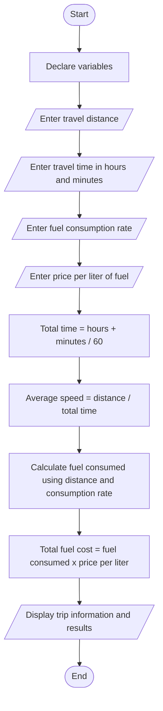

# Task 3: Trip Speed and Fuel Cost Calculator

## 1. Problem Description

Write a C++ program that calculates the average speed of a trip, the amount of fuel consumed, and the total fuel cost. The program should ask the user to enter the travel distance, travel time, fuel consumption rate, and fuel price per liter. It should then perform the necessary calculations and display the results clearly.

## 2. Problem Analysis

### Input
- Total travel distance in kilometers.
- Travel time in hours.
- Additional travel time in minutes.
- Fuel consumption rate in liters per 100 kilometers.
- Price of one liter of fuel in Birr.

### Processing
- Convert the travel time into hours.
- Calculate the average speed.
- Calculate the total fuel consumed.
- Calculate the total fuel cost.

### Output
- Total travel distance.
- Total travel time.
- Average speed in km/h.
- Fuel consumed in liters.
- Total fuel cost in Birr.

## 3. Process

1. Start the program.
2. Declare the required variables.
3. Ask the user to enter the travel distance.
4. Ask the user to enter the travel time in hours and minutes.
5. Ask the user to enter the fuel consumption rate.
6. Ask the user to enter the price per liter of fuel.
7. Convert the travel time into hours by dividing the minutes by 60 and adding the result to the hours.
8. Calculate the average speed by dividing the distance by the total travel time.
9. Calculate the fuel consumed using the distance and fuel consumption rate.
10. Calculate the total fuel cost by multiplying the fuel consumed by the price per liter.
11. Display the trip information and calculated results.
12. End the program.

## 4. Program Design (Algorithm)

### 4.1 Variables: What and How?

| Variable | Type | Why this type? |
|----------|------|----------------|
| distance | double | Distance may contain decimals. |
| hours | int | Travel hours are whole numbers. |
| minutes | int | Travel minutes are whole numbers. |
| totalTime | double | Converted time may contain decimals. |
| fuelConsumption | double | Fuel consumption may contain decimals. |
| fuelPrice | double | Fuel price may contain decimals. |
| averageSpeed | double | Calculated speed may contain decimals. |
| fuelUsed | double | Fuel used may contain decimals. |
| fuelCost | double | Fuel cost may contain decimals. |

### 4.2 Reading the input
```cpp
cout << "Enter distance (km): ";
cin >> distance;

cout << "Enter travel time (hours and minutes): ";
cin >> hours >> minutes;

cout << "Enter fuel consumption (L/100km): ";
cin >> fuelConsumption;

cout << "Enter fuel price per liter (Birr): ";
cin >> fuelPrice;
```
### 4.3 Calculation

- First, convert the travel time into hours:
```cpp
totalTime = hours + (minutes / 60.0);
```
- Calculate average speed:
```cpp
averageSpeed = distance / totalTime;
```
- Calculate fuel used:
```cpp
fuelUsed = (distance * fuelConsumption) / 100;
```
- Calculate fuel cost:
```cpp
fuelCost = fuelUsed * fuelPrice;
```
### 4.4 Printing the result
```cpp
cout << fixed << setprecision(2);

cout << "Average speed: " << averageSpeed << " km/h" << endl;
cout << "Fuel used: " << fuelUsed << " liters" << endl;
cout << "Fuel cost: " << fuelCost << " Birr" << endl;
```

## 5. Flowchart



## 6. C++ Source Code

The complete C++ source code is available in Trip_Speed_and_Fuel_Cost_System.cpp.

## 7. Sample Test Runs

### Test 1

Input:
- Distance: 150 km
- Travel time: 2 hours and 30 minutes
- Fuel consumption: 8 liters per 100 km
- Fuel price: 60 Birr per liter

Calculation:

Total time:
2 + (30 / 60) = 2.5 hours

Average speed:
150 / 2.5 = 60 km/h

Fuel consumed:
(150 * 8) / 100 = 12 liters

Total fuel cost:
12 * 60 = 720 Birr

Output:
- Distance: 150 km
- Total travel time: 2.50 hours
- Average speed: 60.00 km/h
- Fuel consumed: 12.00 liters
- Total fuel cost: 720.00 Birr
